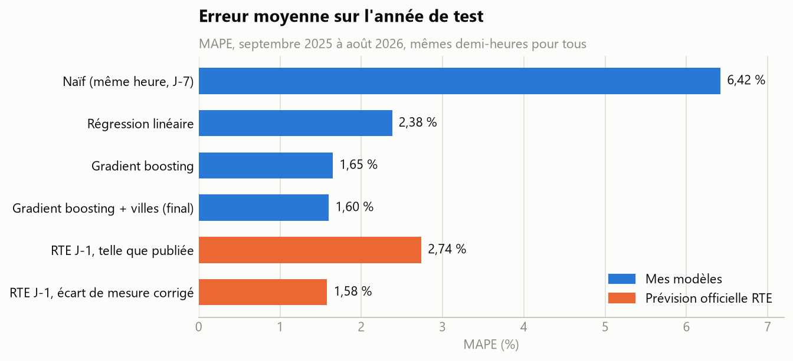
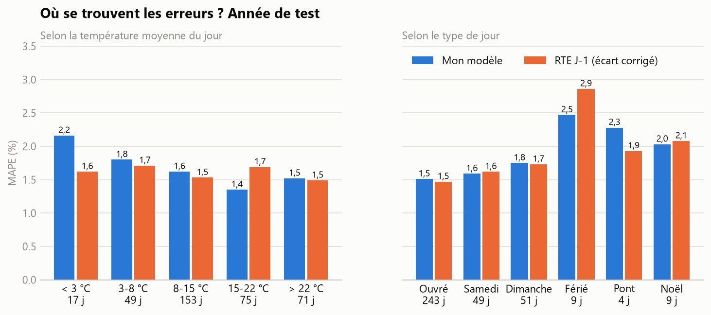
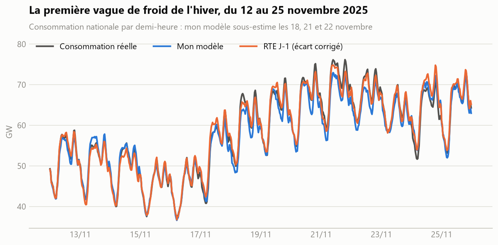

# Prévision de la consommation électrique française, comparée à RTE

Prévoir la veille pour le lendemain la consommation électrique nationale, par demi-heure, et comparer honnêtement le résultat à la prévision officielle de RTE.

**Résultat : mon modèle atteint 1,60 % d'erreur moyenne (MAPE) sur un an de test. La prévision J-1 de RTE est à 2,74 % telle que publiée, mais à 1,58 % une fois corrigé un écart de mesure. Les deux sont donc à égalité, et RTE reste nettement meilleur pendant les vagues de froid.**

## Résultats

Année de test : septembre 2025 à août 2026, soit 17 511 demi-heures, les mêmes pour tous les modèles.

| Modèle | MAPE | Erreur moyenne | Biais |
|---|---|---|---|
| Naïf : même heure, 7 jours avant | 6,42 % | 3 446 MW | −13 MW |
| Régression linéaire | 2,38 % | 1 190 MW | −353 MW |
| Gradient boosting (météo nationale) | 1,65 % | 861 MW | −149 MW |
| **Gradient boosting + températures par ville (modèle final)** | **1,60 %** | **828 MW** | **−144 MW** |
| RTE J-1, telle que publiée | 2,74 % | 1 388 MW | −1 122 MW |
| **RTE J-1, écart de mesure corrigé** | **1,58 %** | **808 MW** | **−8 MW** |

L'écart entre mon modèle et RTE corrigé est compris entre −0,09 et +0,12 point (intervalle à 95 %, rééchantillonnage par jour) : il n'est pas distinguable de zéro.



## Le piège de la comparaison

Comparée brutalement, la prévision de RTE semble mauvaise : 2,74 %. Mais elle est en moyenne 1 100 MW trop basse, tous les ans depuis 2023, ce qui ne ressemble pas à une erreur de prévision.

L'explication : la consommation publiée en temps réel est remplacée, des semaines ou des mois plus tard, par une valeur révisée issue des compteurs. RTE prévoit la valeur temps réel ; mon modèle est entraîné et noté sur la valeur révisée. Nous ne visons pas la même cible.

| Prévision J-1 de RTE comparée à… | Écart moyen | MAPE |
|---|---|---|
| la consommation révisée (année de test) | −1 122 MW | 2,74 % |
| la consommation temps réel (1er septembre au 10 octobre 2026) | +201 MW | 1,44 % |

Sur les 40 jours où la valeur temps réel est encore disponible, l'écart disparaît. Ces 40 jours ne sont pas la même période que l'année de test : c'est un indice fort, pas une preuve.

**La correction appliquée.** Chaque jour, pour chaque demi-heure, j'ajoute à la prévision de RTE son écart moyen des 28 jours précédents (jusqu'à J-2). La correction n'utilise que le passé. La forme de la correction a été choisie sur l'année de validation, en retenant celle qui avantage le plus RTE. Appliquée à mon propre modèle, elle ne change presque rien (1,60 % → 1,62 %).

Cette correction reste une estimation : elle retire l'écart moyen, pas la révision exacte de chaque demi-heure.

## Analyse des erreurs



- **Vagues de froid : mon point faible.** Sous 3 °C de moyenne journalière (17 jours), mon erreur monte à 2,2 % contre 1,6 % pour RTE. Mes trois pires journées sont les 18, 21 et 22 novembre 2025, la première vague de froid de l'hiver, avec environ 3 000 MW de sous-estimation.
- **Jours fériés : bien gérés.** Le modèle naïf se trompe de 11 % ces jours-là, le mien de 2,5 %, RTE de 2,9 % (9 jours seulement, à prendre avec prudence).
- **Ponts : RTE est meilleur** (1,9 % contre 2,3 %), mais sur 4 jours.
- **Jours doux (15 à 22 °C) : mon modèle est meilleur** (1,4 % contre 1,7 %).



Explication probable, non vérifiée : le modèle voit peu de journées très froides à l'entraînement, et au début de l'hiver ses repères de consommation récente datent encore de jours doux.

## Méthode

**Données**
- Consommation et prévisions de RTE : éCO2mix national, données consolidées et définitives (ODRE), au pas de 30 minutes, de janvier 2018 à août 2026.
- Météo : Open-Meteo, pour 10 grandes villes ; température, nébulosité et vent.
- Calendrier : jours fériés, veilles et lendemains de fériés, ponts, semaine de Noël.

**Mêmes conditions que RTE**
- La prévision du jour J est émise la veille à 12 h. Le modèle ne connaît la consommation que jusqu'à ce moment.
- Sur les années évaluées, le modèle reçoit la météo telle qu'elle était **prévue** à ce moment, pas la météo réellement observée. Les prévisions archivées n'existent que depuis 2024 ; avant, l'entraînement utilise la météo observée.

**Validation qui respecte le temps**
- Année de validation : septembre 2024 à août 2025, entraînement sur tout ce qui précède. Elle sert à choisir entre les variantes.
- Année de test : septembre 2025 à août 2026, entraînement sur tout ce qui précède. Elle n'a été regardée qu'une fois, à la fin.
- Les réglages du modèle sont fixés à l'avance, sans optimisation sur les années évaluées.

**Ce que vaut chaque information** (année de validation, gradient boosting de base à 1,72 %)

| Variante | MAPE |
|---|---|
| Avec les températures de chaque ville | 1,62 % |
| Avec la météo réellement observée | 1,69 % |
| Consommation connue jusqu'à J-2 seulement | 1,96 % |
| Entraînement limité à la période avec prévisions météo (depuis 2024) | 3,03 % |

## Limites

- **L'heure d'émission de RTE n'est pas publiée.** J'ai supposé 12 h la veille. Si RTE prévoit plus tard, il dispose de plus d'information que mon modèle.
- **Mes données passées sont trop propres.** Le modèle utilise la consommation révisée de la veille, que personne n'avait le jour même.
- **La correction de RTE est une estimation**, comme expliqué plus haut.
- **Une seule année de test** : 17 jours de grand froid et 9 jours fériés, c'est peu pour conclure sur ces cas.

## Pistes

- Archiver chaque semaine les données temps réel pour pouvoir, dans un an, comparer sur la même cible que RTE.
- Mieux traiter le froid : davantage de poids aux journées froides, prévisions météo de plusieurs modèles.
- Ajouter les vacances scolaires par zone.

## Reproduire

Avec [uv](https://docs.astral.sh/uv/) :

```
uv sync
uv run python scripts/01_download.py        # données (quelques minutes)
uv run python scripts/02_check_features.py  # contrôles, dont l'absence de fuite d'information
uv run python scripts/03_train.py           # entraînement et prédictions
uv run python scripts/04_evaluate.py        # scores, comparaison avec RTE, analyse des erreurs
uv run python scripts/05_figures.py         # graphiques
```

```
conso/config.py       périodes, villes, heure d'émission
conso/data.py         téléchargement et chargement
conso/features.py     variables d'entrée (calendrier, météo, consommation passée)
conso/models.py       les trois modèles
conso/evaluation.py   scores, correction de l'écart, intervalle de confiance
results/              tableaux et graphiques
```
